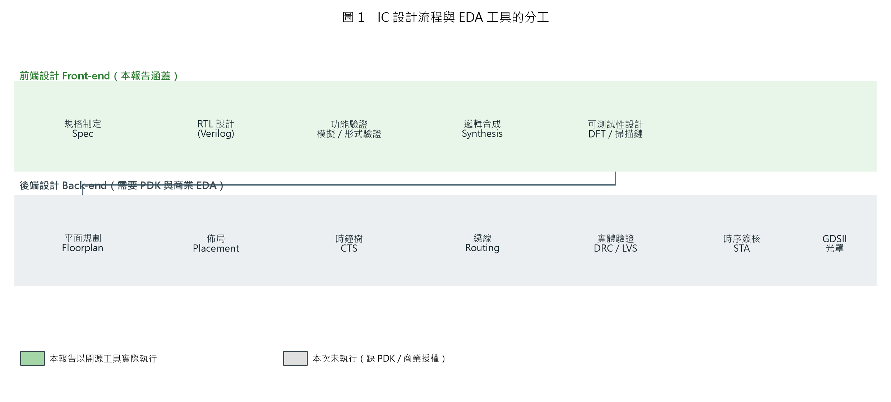
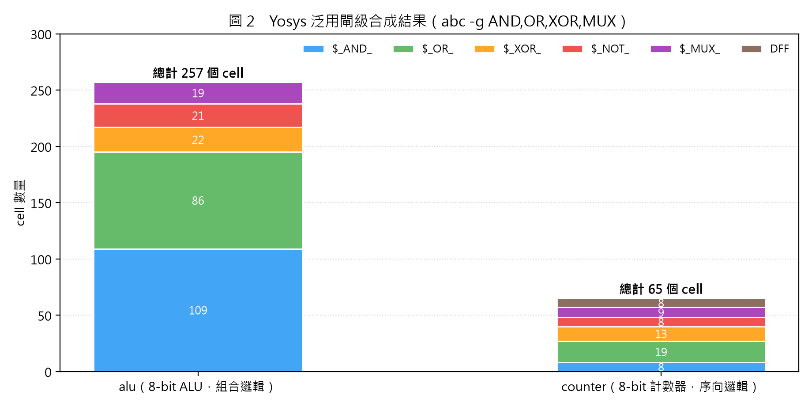
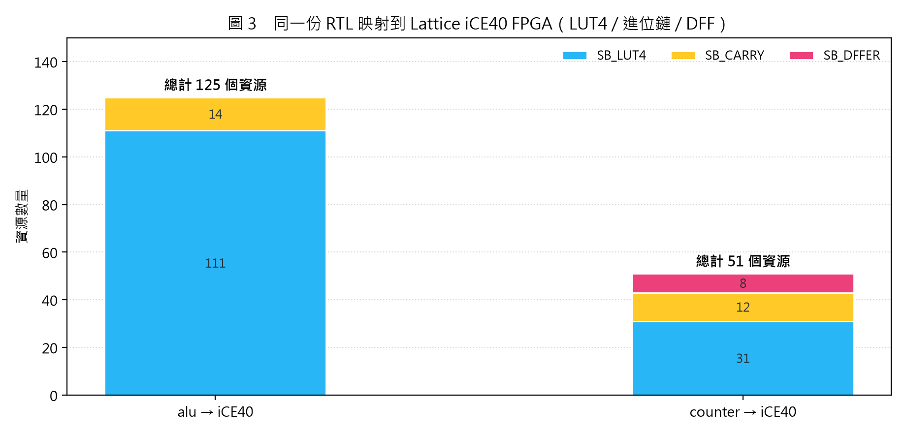
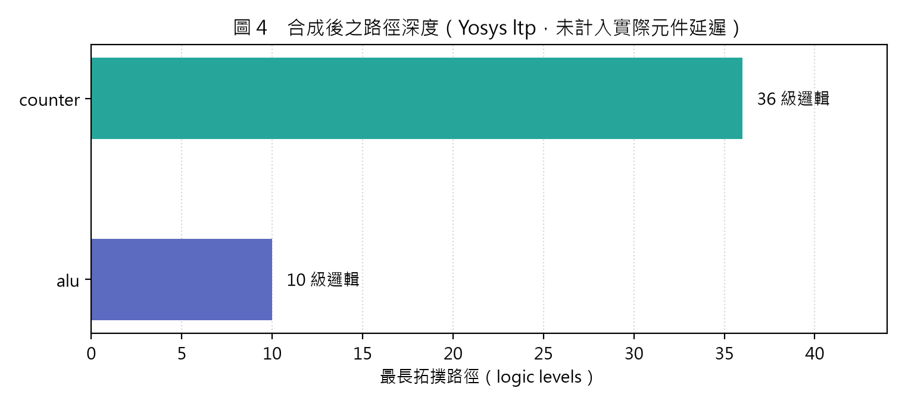

# IC 設計的 EDA 是什麼？

> **一份「先動手、再寫報告」的 EDA 入門報告**
> 使用開源 EDA 工具鏈（Yosys 0.70）實際完成一份 RTL 的合成、驗證與 FPGA 映射，
> 再用實驗數據說明 EDA 在 IC 設計流程中扮演的角色。

| 項目 | 內容 |
|---|---|
| 報告主題 | IC 設計的 EDA（Electronic Design Automation） |
| 實驗工具 | Yosys 0.70（YoWASP/WASI 版）、ABC、Python 3.11 |
| 實驗設計 | 8-bit ALU、8-bit up/down counter |
| 實驗日期 | 2026 年 11 月 |
| 附件 | `rtl/`、`scripts/`、`log/`、`out/` |

---

## 目錄

1. [摘要](#一摘要)
2. [EDA 是什麼](#二eda-是什麼)
3. [EDA 在 IC 設計流程中的位置](#三eda-在-ic-設計流程中的位置)
4. [EDA 工具的分類與產業版圖](#四eda-工具的分類與產業版圖)
5. [實作：用 Yosys 走一遍 EDA 流程](#五實作用-yosys-走一遍-eda-流程)
6. [實驗結果](#六實驗結果)
7. [討論](#七討論)
8. [結論](#八結論)
9. [參考資料](#九參考資料)
10. [附錄](#附錄)

---

## 一、摘要

**EDA（Electronic Design Automation，電子設計自動化）** 是指「用軟體工具自動化 IC／PCB／FPGA 設計流程」的整套技術與產業。一顆現代晶片包含數百億顆電晶體，人類不可能靠手繪完成電路圖、佈局與驗證；EDA 把設計者的「意圖」（RTL 程式碼、時序限制、製程規則）轉換成可製造的幾何圖形（GDSII），並在每個階段自動檢查設計是否正確、是否可製造、是否能達到目標頻率。

本報告先定義 EDA 並說明它在 IC 設計流程中的位置，再**實際使用開源 EDA 工具 Yosys** 對兩個 Verilog 設計（8-bit ALU 與 8-bit 計數器）執行：

- 邏輯合成（technology-independent → 閘級 netlist）
- 以 SAT 求解器做功能驗證（11 項性質全數證明通過）
- 以 miter 電路做等價性檢查（涵蓋全部 2¹⁹ = 524,288 種輸入組合，一次證明）
- 映射到真實 FPGA 元件（Lattice iCE40：LUT4 / Carry / DFF）

結果顯示：同一份 RTL 在「泛用閘」與「FPGA 元件」兩種技術目標下，得到完全不同的電路結構（ALU：257 gates ↔ 111 LUT + 14 Carry），這正是 EDA「以工具取代手工、並隨製程重新優化」的核心價值。

---

## 二、EDA 是什麼

### 2.1 定義

> **EDA = Electronic Design Automation**
> 以電腦輔助設計（CAD）為基礎，針對電子系統（IC、SoC、PCB、FPGA）提供**設計輸入、模擬、合成、分析、佈局、驗證**的自動化工具集合。

它同時是：

| 角度 | 說明 |
|---|---|
| 技術 | 一套把「設計意圖」編譯成「可製造實體」的演算法與資料流（RTL → netlist → layout → GDSII） |
| 工具 | 合成器、模擬器、佈局佈線器、時序分析器、實體驗證器…… |
| 產業 | 由 Synopsys、Cadence、Siemens EDA 等廠商構成的上游關鍵產業 |

### 2.2 為什麼需要 EDA？

一顆 3 nm 世代的 SoC 可能有 **200 億顆以上電晶體**、十幾層金屬、數千個時脈網域。若沒有 EDA：

- **規模**：手工繪製 200 億顆電晶體的電路圖與佈局，工作量以「人年 × 百萬」計。
- **正確性**：时序、電壓降（IR drop）、串音（crosstalk）等問題無法用肉眼檢查，只能靠工具做 STA／DRC／LVS。
- **迭代速度**：設計變更一次，EDA 可在數小時內重新合成、重新佈局、重新驗證；人工則需數月。
- **可重現性**：同一份 RTL 搭配不同製程庫（PDK）即可快速 porting 到下一個節點。

換句話說，**EDA 是「摩爾定律的實現工具」**：製程提供電晶體，EDA 負責把電晶體變成可用的電路。

### 2.3 EDA 的三個核心價值

1. **抽象化（Abstraction）**：設計者只寫行為層（RTL），不必管閘極與佈局；工具負責逐層展開。
2. **自動化（Automation）**：合成、佈局、繞線、時鐘樹、測試插入全部由演算法完成。
3. **可保證（Correctness）**：模擬、形式驗證、等價性檢查、實體驗證（DRC/LVS）、時序簽核，逐層保證「設計＝規格」且「設計＝可製造」。

---

## 三、EDA 在 IC 設計流程中的位置

IC 設計大致可分為**前端（Front-end）**與**後端（Back-end）**，加上最後的**製造與封測**。



### 3.1 各階段與對應工具

| 階段 | 目的 | 典型 EDA 工具 |
|---|---|---|
| 規格制定 | 定義功能、效能、功耗、面積（PPA）目標 | Excel、SystemC/TLM 模型 |
| RTL 設計 | 以 Verilog / SystemVerilog / VHDL 描述電路行為 | 編輯器、VS Code、Eclipse |
| 功能模擬 | 以測試平台（testbench）驗證行為 | Synopsys VCS、Cadence Xcelium、Siemens Questa、Verilator、Icarus Verilog |
| Lint / CDC | 檢查語法風格、跨時脈域問題 | SpyGlass、Questa Lint |
| 形式驗證 | 以數學方式證明性質（property）恆成立 | JasperGold、VC Formal、Yosys SAT |
| 邏輯合成 | RTL → 閘級 netlist，並做邏輯優化 | Design Compiler、Genus、Yosys |
| DFT | 插入掃描鏈、BIST，使晶片可測試 | DFT Compiler、Modus、Tessent |
| 平面規劃 / 佈局 / CTS / 繞線 | 決定元件位置與連線（P&R） | IC Compiler II、Innovus、OpenROAD |
| 寄生參數抽取 + STA | 計算真實延遲，確認時序收斂 | PrimeTime、Tempus、OpenSTA |
| 實體驗證 | DRC（製程規則）、LVS（佈局 vs 電路） | Calibre、PVS、KLayout、Magic |
| 簽核與光罩 | 產生 GDSII、送交晶圓廠 | Calibre、EDA 全流程整合 |

### 3.2 一張圖看懂「EDA 在哪裡」

- **前端**：把「想法」變成「電路」——RTL、模擬、合成、DFT。
- **後端**：把「電路」變成「幾何」——P&R、時序、DRC/LVS。
- **製造**：把「幾何」變成「晶片」——光罩、晶圓製程、封測。

本報告的實驗落在**前端**：RTL 撰寫 → 功能驗證 → 邏輯合成。

---

## 四、EDA 工具的分類與產業版圖

### 4.1 商業三大廠

| 廠商 | 代表產品 | 主要領域 |
|---|---|---|
| Synopsys | Design Compiler、VCS、IC Compiler II、PrimeTime、JasperGold | 合成、模擬、P&R、時序、形式驗證 |
| Cadence | Genus、Xcelium、Innovus、Tempus、Virtuoso | 合成、模擬、P&R、類比設計 |
| Siemens EDA（原 Mentor） | Questa、Calibre、Modus、Tessent | 模擬、實體驗證、DFT、測試 |

三大廠長期掌握主要市佔，並以「點工具（point tool）+ 完整流程（flow）」的綁定方式形成高門檻。

### 4.2 開源 EDA 生態

| 工具 | 功能 | 特色 |
|---|---|---|
| **Yosys** | RTL 合成、形式驗證（SAT） | 開源合成器事實標準，支援 FPGA 與 ASIC 流程 |
| **ABC** | 邏輯優化與技術映射 | 常與 Yosys 搭配 |
| **Verilator** | 高速 Verilog 模擬（編譯成 C++） | 業界驗證 RTL 常用 |
| **Icarus Verilog** | Verilog 模擬 | 輕量、教學常用 |
| **OpenROAD / OpenLane** | RTL → GDSII 全流程 | 支援 SkyWater 130 nm PDK |
| **Magic / KLayout** | 佈局編輯與 DRC/LVS | KLayout 亦廣泛用於光罩資料檢視 |
| **ngspice / Xyce** | 電路模擬（SPICE） | 類比與混合訊號 |
| **OpenSTA** | 靜態時序分析 | 搭配 OpenROAD 使用 |

開源工具鏈讓學生與新創能用**零授權成本**跑完整流程，也是本報告能在一般筆電上完成實驗的原因。

---

## 五、實作：用 Yosys 走一遍 EDA 流程

### 5.1 實驗環境

| 項目 | 規格 |
|---|---|
| 作業系統 | Windows 11 家用版 |
| CPU / RAM | AMD Ryzen 7 7445HS / 16 GB |
| EDA 工具 | Yosys 0.70（git sha1 `28ba3cb92`，YoWASP/WASI 版，透過 pip 安裝） |
| 輔助工具 | ABC（內建於 Yosys）、Python 3.11.9 + matplotlib |
| 技術目標 | ① 泛用閘（AND/OR/XOR/NOT/MUX）② Lattice iCE40 FPGA（LUT4/Carry/DFF） |

> 選用 YoWASP 版 Yosys 的原因：Windows 原生版需自行編譯，而 `pip install yowasp-yosys` 可直接取得可在 Windows 執行的 WASM 版本，指令與原生版一致。

### 5.2 設計輸入（RTL）

**設計 A：8-bit ALU（組合邏輯）**

```verilog
module alu #(parameter W = 8) (
    input  wire [W-1:0] a, b,
    input  wire [2:0]   op,
    output reg  [W-1:0] y
);
    always @* begin
        case (op)
            3'd0: y = a + b;          // ADD
            3'd1: y = a - b;          // SUB
            3'd2: y = a & b;          // AND
            3'd3: y = a | b;          // OR
            3'd4: y = a ^ b;          // XOR
            3'd5: y = a << b[2:0];    // SHL
            3'd6: y = a >> b[2:0];    // SHR
            default: y = {W{1'b0}};   // NOP
        endcase
    end
endmodule
```

**設計 B：8-bit up/down 計數器（序向邏輯）**

```verilog
module counter #(parameter W = 8) (
    input  wire         clk, rst_n, en, up, ld,
    input  wire [W-1:0] load,
    output reg  [W-1:0] q,
    output wire         zero
);
    assign zero = (q == {W{1'b0}});

    always @(posedge clk or negedge rst_n) begin
        if (!rst_n)     q <= {W{1'b0}};
        else if (ld)    q <= load;
        else if (en)    q <= up ? q + 1'b1 : q - 1'b1;
    end
endmodule
```

### 5.3 合成流程

```text
read_verilog  →  hierarchy  →  synth  →  abc  →  stat  →  write_verilog
   (RTL)        (檢查階層)    (優化)   (技術映射) (統計)    (閘級 netlist)
```

實際指令（節錄自 `scripts/synth_alu.ys`）：

```tcl
read_verilog rtl/alu.v
hierarchy -check -top alu
synth -top alu                       # proc/opt/fsm/memory/techmap/abc 的整合流程
abc -g AND,OR,XOR,MUX                # 映射到 4 種基本閘
opt_clean
stat
write_verilog -noattr out/alu_netlist.v
show -format dot -prefix out/alu_netlist
```

FPGA 目標則改用真實元件庫：

```tcl
read_verilog rtl/alu.v
synth_ice40 -top alu -json out/alu_ice40.json   # 映射到 SB_LUT4 / SB_CARRY / SB_DFF
stat
ltp -noff                                       # 最長拓撲路徑（邏輯級數）
```

### 5.4 驗證流程

**(a) 性質證明（property checking）**：對 ALU 的 8 種操作各下一個「輸入 → 期望輸出」的證明；對計數器做 2 個時脈邊界的 bounded model checking（BMC）。

```tcl
sat -verify -prove y 8'd5 -set a 8'd2 -set b 8'd3 -set op 3'd0   # 2 + 3 = 5
sat -seq 2 -verify -prove-skip 1 \
    -set-at 1 q 8'h00 -set-at 1 en 1 -set-at 1 up 1 ... \
    -prove q 8'h01                                              # 0x00 → 0x01
```

**(b) 等價性檢查（LEC）**：另外寫一份**風格不同**的 golden model（用 De Morgan 定律、加法器展開等方式實作同一功能），用 miter 電路比較兩者輸出：

```verilog
assign mismatch = (y_impl !== y_ref);
```

只要 SAT 證明 `mismatch` 恆為 0，就等於證明「2¹⁹ 種輸入組合下兩份電路完全等價」——這正是商業流程中 Formality／Conformal 做的事。

---

## 六、實驗結果

### 6.1 閘級合成（ASIC 風格，泛用閘）

| 設計 | 組合邏輯 cells | 序向 cells | 總計 | 合成時間 |
|---|---:|---:|---:|---:|
| `alu` | 257 | 0 | **257** | 0.40 s |
| `counter` | 57 | 8（DFF） | **65** | 0.31 s |

細部組成（Yosys `stat` 原始輸出）：

| Cell 類型 | alu | counter |
|---|---:|---:|
| `$_AND_` | 109 | 8 |
| `$_OR_` | 86 | 19 |
| `$_XOR_` | 22 | 13 |
| `$_NOT_` | 21 | 8 |
| `$_MUX_` | 19 | 9 |
| `$_DFFE_PN0P_` | 0 | 8 |



**觀察**：ALU 的 257 個閘中，加減法器（carry chain）貢獻了大部分 AND/OR/XOR；計數器只有 65 個閘，因為 8-bit 計數器的資料路徑僅是一條 +1/−1 的進位鏈加上 8 個正反器。

### 6.2 FPGA 映射（Lattice iCE40）

| 設計 | SB_LUT4 | SB_CARRY | SB_DFFER | 資源總計 | 邏輯深度 |
|---|---:|---:|---:|---:|---:|
| `alu` | 111 | 14 | 0 | **125** | 10 級 |
| `counter` | 31 | 12 | 8 | **51** | 36 級 |





**觀察**：

- 同一份 `alu.v`，換成 LUT4 架構後只需要 111 個 LUT 就能實現 257 個基本閘的功能——因為一個 4 輸入 LUT 可取代多層 AND/OR 邏輯。
- `counter` 的最長拓撲路徑為 36 級：8-bit 加法的進位必須串列傳遞（ripple carry），且 `up/down` 多工器又疊在進位鏈上。但拓撲級數只是「經過多少個元件」的粗指標，**不等於實際延遲**——`SB_CARRY` 的延遲遠小於 LUT，真正的時序必須在 P&R 之後用 STA 計算。**「同一份 RTL、不同技術庫 → 不同電路」正是 EDA 的價值。**

### 6.3 驗證結果

| 驗證項目 | 方法 | 涵蓋範圍 | 結果 |
|---|---|---|---|
| ALU 8 種操作 | SAT 性質證明 | 每項固定輸入向量 | 8/8 **SUCCESS** |
| 計數器 up / down / load | SAT BMC（2 個時脈） | 每項 1 條轉移 | 3/3 **SUCCESS** |
| ALU 等價性（LEC） | miter + SAT | **全部 2¹⁹ 種輸入組合** | 1/1 **SUCCESS** |

LEC 的 SAT 問題規模：1,187 個變數、3,227 個 clause，求解時間 < 1 秒。

> 註：Yosys 的 `sat` 在 `-seq N` 模式下，第 N 步的狀態是由「第 N 步的輸入」決定，因此 BMC 需要同時約束兩個時間點的輸入；這是撰寫腳本時實際踩到的坑，也記錄在 `scripts/verify.ys` 的註解中。

### 6.4 產出物

| 檔案 | 說明 |
|---|---|
| `out/alu_netlist.v`、`out/counter_netlist.v` | 閘級 netlist（可再餵給其他工具） |
| `out/alu_netlist.dot`、`out/counter_netlist.dot` | Graphviz 電路圖 |
| `out/alu_ice40.json`、`out/counter_ice40.json` | FPGA 映射結果（nextpnr 可用） |
| `log/*.log` | 完整工具輸出（可重現性證據） |

---

## 七、討論

### 7.1 從實驗看 EDA 的作用

| EDA 功能 | 本實驗中的對應 | 若沒有工具 |
|---|---|---|
| 高階合成 | Verilog `case` → 257 個閘 | 需手工設計加減法器與多工器 |
| 邏輯優化 | ABC 化簡、共用子表達式 | 閘數可能多出數倍 |
| 技術映射 | 泛用閘 / iCE40 LUT | 需人工查閱元件庫手繪 |
| 形式驗證 | 11 項 SAT 證明 + LEC | 只能靠少量測試向量「猜」正確性 |
| 可重現 | 腳本 + log | 結果無法回溯 |

### 7.2 本實驗的限制

1. **沒有 PDK / Liberty**：因此只能得到「閘數」與「邏輯級數」，**沒有真實的面積（µm²）、功耗（mW）、延遲（ns）**。商業流程會用 `abc -liberty` 映射到特定製程的標準元件庫，再以 OpenSTA／PrimeTime 計算時序。
2. **沒有佈局佈線**：未執行 floorplan / placement / routing，所以沒有繞線延遲、IR drop、DRC/LVS 結果。
3. **驗證範圍有限**：BMC 只證明 2 個時脈邊界；完整證明需要 k-induction 或 invariant。ALU 的 LEC 則是完整證明。
4. **模擬未執行**：原定以 Icarus Verilog 產生波形，但官方安裝檔被 Windows Defender 判定為威脅並隔離，因此改以形式驗證取代；這也是實務上「模擬 + 形式」互補的典型例子。
5. **合成器差異**：Yosys 與商業合成器（DC/Genus）在優化順序、資源共享、時序導向合成上仍有差距，閘數不能直接類比。

### 7.3 商業 vs 開源

| 面向 | 商業 EDA | 開源 EDA |
|---|---|---|
| 授權 | 高昂（依工具與席次計價） | 免費 |
| 製程支援 | 所有主流 PDK（3 nm～成熟製程） | 以 SkyWater 130 nm、GF180 為主 |
| 收斂能力 | 強（時序、功耗、良率優化） | 較弱，需人工調校 |
| 可修改性 | 封閉 | 可修改、可研究 |
| 適用場景 | 量產晶片 | 教學、研究、原型、小量 ASIC |

### 7.4 趨勢

- **AI 輔助 EDA**：Synopsys DSO.ai、Cadence Cerebrus 以強化學習搜尋 P&R 參數；生成式 AI 協助寫 RTL／testbench。
- **雲端 EDA**：把動輒數千核心的 P&R 工作搬到雲端。
- **Chiplet / 先進封裝**：EDA 需處理 2.5D/3D 整合與跨晶粒時序。
- **開源 PDK 成熟**：SkyWater 130 nm、GF180MCU 讓學界能做出可下線的設計。

---

## 八、結論

1. **EDA 是 IC 設計的「編譯器 + 品管系統」**：把 RTL 編譯成幾何（GDSII），並在每一層保證正確性與可製造性。
2. **EDA 不是單一軟體，而是一條工具鏈**：前端（模擬、合成、DFT）與後端（P&R、STA、DRC/LVS）各自解決不同抽象層的問題。
3. **實驗證明 EDA 的三個價值**：
   - 抽象化：二十多行 Verilog 就能描述一個 8-bit ALU；
   - 自動化：0.4 秒內完成 257 個閘的合成與優化；
   - 正確性：SAT 一次證明 524,288 種輸入組合的等價性。
4. **同一份 RTL 會因技術庫不同而產生不同電路**（257 gates ↔ 111 LUT + 14 Carry），所以 EDA 的價值不只在「畫圖」，更在「針對目標製程重新優化」。
5. **沒有 EDA，現代晶片不可能存在**；而開源工具鏈已足以讓學生在筆電上完整體驗這條流程。

---

## 九、參考資料

1. Yosys Open SYnthesis Suite — <https://yosyshq.net/yosys/>
2. Yosys 文件（`synth`、`abc`、`sat`、`stat`、`ltp` 指令）— <https://yosyshq.readthedocs.io/>
3. YoWASP（WebAssembly 版開源 EDA）— <https://yowasp.org/>
4. ABC: A System for Sequential Synthesis and Verification — <https://people.eecs.berkeley.edu/~alanmi/abc/>
5. OpenROAD Project — <https://theopenroadproject.org/>
6. OpenLane — <https://github.com/The-OpenROAD-Project/OpenLane>
7. SkyWater PDK — <https://github.com/google/skywater-pdk>
8. KLayout — <https://www.klayout.de/>
9. Magic VLSI Layout Tool — <http://opencircuitdesign.com/magic/>
10. Verilator — <https://www.veripool.org/verilator/>
11. ngspice — <https://ngspice.sourceforge.io/>
12. Synopsys — <https://www.synopsys.com/>
13. Cadence — <https://www.cadence.com/>
14. Siemens EDA — <https://eda.sw.siemens.com/>

---

## 附錄

### A. 檔案結構

```text
eda_report/
├── README.md                  # 本報告
├── rtl/
│   ├── alu.v                  # 8-bit ALU
│   ├── alu_ref.v              # LEC 用的 golden model
│   ├── counter.v              # 8-bit up/down counter
│   └── lec_alu.v              # miter（等價性檢查）
├── scripts/
│   ├── synth_alu.ys           # ALU 閘級合成
│   ├── synth_counter.ys       # counter 閘級合成
│   ├── synth_fpga.ys          # iCE40 FPGA 映射
│   ├── verify.ys              # 11 項 SAT 驗證
│   ├── lec.ys                 # 等價性檢查
│   ├── make_figures.py        # 產生報告圖表
│   └── run_all.ps1            # 一鍵重跑
├── log/                       # Yosys 完整輸出
└── out/                       # netlist、dot、json、圖檔
```

### B. 重現步驟

```powershell
# 1. 安裝工具
python -m pip install yowasp-yosys

# 2. 設定路徑（Windows）
$ys = "$env:LOCALAPPDATA\Programs\Python\Python311\Scripts\yowasp-yosys.exe"

# 3. 合成
& $ys -l log/alu_synth.log     scripts/synth_alu.ys
& $ys -l log/counter_synth.log scripts/synth_counter.ys

# 4. FPGA 映射
& $ys -l log/fpga.log scripts/synth_fpga.ys

# 5. 驗證
& $ys -l log/verify.log scripts/verify.ys
& $ys -l log/lec.log    scripts/lec.ys

# 6. 產圖
python scripts/make_figures.py
```

或直接執行 `scripts/run_all.ps1`。

### C. 名詞對照

| 縮寫 | 全名 | 中文 |
|---|---|---|
| EDA | Electronic Design Automation | 電子設計自動化 |
| RTL | Register Transfer Level | 暫存器轉移層 |
| LEC | Logical Equivalence Checking | 邏輯等價性檢查 |
| SAT | Boolean Satisfiability | 布林可滿足性 |
| BMC | Bounded Model Checking | 有界模型檢查 |
| STA | Static Timing Analysis | 靜態時序分析 |
| P&R | Place and Route | 佈局與繞線 |
| CTS | Clock Tree Synthesis | 時鐘樹合成 |
| DFT | Design for Testability | 可測試性設計 |
| DRC | Design Rule Check | 製程規則檢查 |
| LVS | Layout vs Schematic | 佈局與電路圖比對 |
| PDK | Process Design Kit | 製程設計套件 |
| GDSII | Graphic Data System II | 積體電路佈局標準格式 |
| PPA | Power / Performance / Area | 功耗／效能／面積 |
| LUT | Look-Up Table | 查表（FPGA 基本邏輯單元） |
